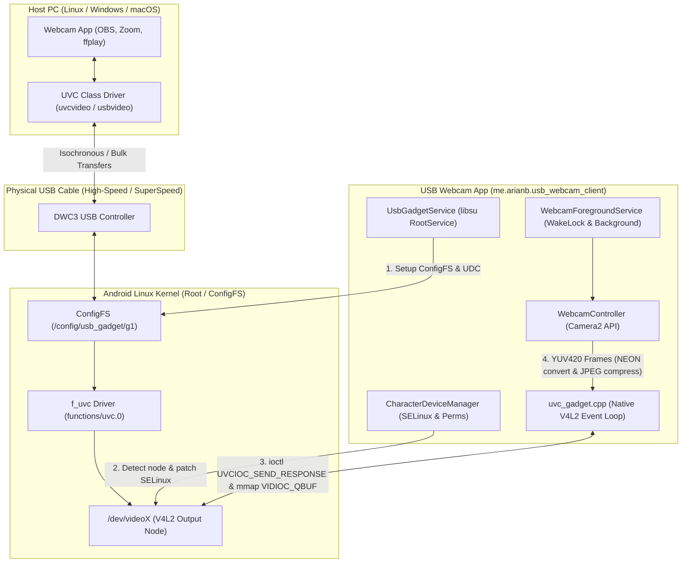

# Android USB Webcam Client (UVC Gadget)

[-green.svg)](https://developer.android.com)
[](https://kernel.org)
[](LICENSE)

A root-enabled Android application that exposes your phone's physical cameras (via Camera2 API) as a hardware-level **USB Video Class (UVC 1.1)** webcam (`/dev/videoX`) directly over Linux ConfigFS.

Because it presents itself as a true standard USB webcam, it requires **zero drivers or companion software** on the host computer. It works out-of-the-box with **Linux, Windows, macOS, ChromeOS**, and applications like **OBS Studio, Zoom, Google Meet, Microsoft Teams, Discord, and WebRTC browsers**.

Forked and repurposed from the ConfigFS and `libsu` `RootService` foundation of [`Arian04/android-hid-client`](https://github.com/Arian04/android-hid-client).

---

## ⚡ Quick Start

1. **Prerequisites**:
   - A rooted Android device running **Magisk**, **KernelSU**, or **APatch**.
   - Kernel with USB ConfigFS and UVC support enabled (`CONFIG_USB_CONFIGFS=y` and `CONFIG_USB_CONFIGFS_F_UVC=y`).
2. **Install & Permissions**:
   - Install the APK and grant **Root** privileges when prompted by your root manager.
   - Grant **Camera** permission.
3. **Start Streaming**:
   - Connect your phone to your computer with a USB cable.
   - Tap **"Start USB Webcam"**.
   - Open your favorite camera software on your computer (e.g. `ffplay /dev/video0`, OBS Studio, Windows Camera, or Photo Booth) and select **"USB Webcam Client"**!

---

## 🚀 Key Features & Highlights

- **Standard Hardware UVC 1.1 Emulation**:
  - Exposes USB Video Class descriptors via ConfigFS (`functions/uvc.0`), recognized natively by OS-level UVC drivers (`uvcvideo` on Linux, `usbvideo.sys` on Windows, and macOS UVC class drivers).
- **Dual Stream Formats & Resolution Profiles**:
  - **MJPEG (`streaming/mjpeg/m`)**:
    - `1080p` (1920×1080) @ 60, 30, 15 fps
    - `720p` (1280×720) @ 60, 30, 15 fps
    - `360p` (640×360) @ 60, 30, 15 fps
  - **Uncompressed YUYV (`streaming/uncompressed/u`)**:
    - `720p` (1280×720) @ 15, 10 fps
    - `480p` (640×480) @ 30, 15, 10 fps
    - `360p` (640×360) @ 30, 15, 10 fps
- **Safe Composite USB & DWC3 Endpoint Management**:
  - Automatically unlinks endpoint-heavy OEM vendor functions (such as `ffs.mtp`, `ss_acm.0`, `ss_mon.mtp`) while the webcam is active to prevent USB controller TX FIFO allocation failures and endpoint exhaustion on Qualcomm DWC3 / Synopsys USB cores.
  - Maintains `uvc.0` + `ffs.adb` active concurrently (or pure UVC-only mode if selected in Settings) and automatically restores your original USB configuration when you tap **Stop**.
- **Native C++ V4L2 Control & Streaming Engine (`uvc_gadget.cpp`)**:
  - Implements the complete UVC userspace state machine responding to `UVC_EVENT_SETUP` (`VS_PROBE_CONTROL` / `VS_COMMIT_CONTROL` via `UVCIOC_SEND_RESPONSE`), `UVC_EVENT_DATA`, `UVC_EVENT_STREAMON`, and `UVC_EVENT_STREAMOFF`.
  - Zero-IPC, zero-GC memory pipeline: operates on `V4L2_MEMORY_MMAP` output buffers, executing native `-O3` YUV420 planar crop, scale, rotation, mirroring, and ARM NEON-accelerated JPEG compression directly into native buffers.
- **Battery-Saving Headless Streaming**:
  - Operates inside an Android Foreground Service (`foregroundServiceType="camera"`) holding a partial wake lock, allowing continuous high-framerate streaming with the phone display powered completely off.
  - Viewfinder preview is disabled by default to eliminate GPU, composition, and display power draw, but can be enabled on-demand for framing.
- **Rich Camera & Lens Controls**:
  - Switch between any physical sensor (rear main, ultra-wide, telephoto, front-facing camera).
  - On-the-fly orientation adjustment (0°, 90°, 180°, 270°) and horizontal mirroring.
  - Real-time MJPEG quality slider (50% – 95%) and live FPS / format telemetry.

---

## 🛠️ Architecture & How It Works

### Comparison: HID Client vs. UVC Webcam Client

| Component | `android-hid-client` (Upstream) | `android-usb-webcam` (This Fork) |
| :--- | :--- | :--- |
| **Kernel Gadget** | `functions/hid.keyboard` & `functions/hid.touchpad` | `functions/uvc.0` (Control + MJPEG & YUYV Streaming) |
| **Exposed Device** | Character devices `/dev/hidg0`, `/dev/hidg1` | V4L2 Video Output node `/dev/videoX` |
| **Data Flow** | Unidirectional raw HID byte reports (keys / pointer) | Bidirectional UVC control negotiation + continuous high-speed video frames |
| **SELinux Context** | `allow appdomain device chr_file { getattr open rw }` | `allow appdomain { device video_device } chr_file { getattr open rw ioctl map }` |
| **Native Engine** | Userspace `uhid` character writes | Complete V4L2 UVC gadget event loop & buffer streamer (`uvc_gadget.cpp`) |
| **Input Source** | Touchpad gestures & keyboard input views | Android Camera2 API hardware capture pipeline |



---

## 🧩 Technical Deep Dive

### 1. ConfigFS Descriptor Configuration (`UsbGadgetService.kt`)
The root service manages the ConfigFS hierarchy under `/config/usb_gadget/g1/functions/uvc.0`:
- **Control Interface**: Defines standard UVC 1.1 VideoControl descriptors (`control/header/h` linked to `control/class/fs/h` and `control/class/ss/h`).
- **Streaming Formats**:
  - `streaming/mjpeg/m`: MJPEG format descriptor with 3 frame sizes (360p, 720p, 1080p) supporting 60, 30, and 15 fps intervals.
  - `streaming/uncompressed/u`: Uncompressed YUY2 format descriptor with 3 frame sizes (360p, 480p, 720p) supporting 30, 15, and 10 fps intervals.
- **Speed Class Symlinks**: Linked to `streaming/class/fs/h`, `streaming/class/hs/h`, and `streaming/class/ss/h`.
- **IAD (Interface Association Descriptor)**: Sets `bDeviceClass = 0xEF`, `bDeviceSubClass = 0x02`, `bDeviceProtocol = 0x01` on the root gadget descriptor so host operating systems enumerate the composite device cleanly.

### 2. DWC3 FIFO & Endpoint Optimization
Many OEM ROMs (such as Samsung One UI) link several heavy USB functions by default (`ffs.mtp`, `ss_acm.0`, `ffs.adb`, `ss_mon.mtp`), exhausting hardware endpoints on Synopsys DesignWare Cores (DWC3). When active, `UsbGadgetService`:
1. Saves the existing configuration state into a persistent temporary backup file (`/data/local/tmp/usb_webcam_saved_links.txt`).
2. Temporarily unlinks MTP, ACM, and monitor endpoints from `configs/b.1/`.
3. Links `functions/uvc.0` (as `f1`) and `functions/ffs.adb` (as `f2`).
4. Re-binds the UDC (USB Device Controller).
5. Restores all original vendor function symlinks seamlessly upon stopping.

### 3. V4L2 Gadget Node Auto-Discovery & SELinux
When `f_uvc` binds to the UDC, the kernel creates a new V4L2 output node in `/sys/class/video4linux/video*`. `CharacterDeviceManager` scans `/sys/class/video4linux/` for nodes whose sysfs target references the active USB gadget / UDC controller, applies `chown` to the application UID, sets permissions to `0660`, and injects live SELinux policies (`allow appdomain { device video_device } chr_file { getattr open read write ioctl map }`) via `magiskpolicy`, `ksud`, or `apd`.

### 4. Native V4L2 Event Handling & Frame Pipeline (`uvc_gadget.cpp`)
Userspace communication with the `f_uvc` kernel driver uses standard V4L2 event notifications:
1. **Probe & Commit Negotiation**: Listens for `UVC_EVENT_SETUP` via `VIDIOC_DQEVENT`. When the host sends `UVC_GET_CUR`, `UVC_GET_MIN`, `UVC_GET_MAX`, or `UVC_SET_CUR` for `VS_PROBE_CONTROL` / `VS_COMMIT_CONTROL`, the native daemon negotiates format and framerate and responds via `ioctl(fd, UVCIOC_SEND_RESPONSE)`.
2. **Stream Lifecycle**:
   - `UVC_EVENT_STREAMON`: Configures V4L2 format (`VIDIOC_S_FMT`), allocates `V4L2_MEMORY_MMAP` buffers (`VIDIOC_REQBUFS`), pre-queues initial buffers, and initiates output streaming (`VIDIOC_STREAMON`).
   - `UVC_EVENT_STREAMOFF`: Stops the stream (`VIDIOC_STREAMOFF`), unmaps buffers, and enters standby.
3. **Zero-Copy Frame Processing**:
   - Dequeues empty buffers with `VIDIOC_DQBUF`.
   - Converts Camera2 `YUV_420_888` planes (handling arbitrary row and pixel strides) into packed `YUYV` or compressed `NV21` with SIMD acceleration.
   - For MJPEG: compresses via Android's hardware-accelerated Skia `libjpeg-turbo` directly into pre-allocated direct byte buffers with zero heap allocation.
   - Re-queues populated buffers with monotonic timestamps using `VIDIOC_QBUF`.

---

## 🛠️ Building from Source

### Requirements
- Linux or macOS development environment
- JDK 17 or JDK 21
- Android SDK (API 36) & NDK 28.2+
- CMake 3.22.1+

### Build Steps
```bash
# Clone the repository
git clone https://github.com/AndrewChqng/android-usb-webcam.git
cd android-usb-webcam

# Build Debug APK
./gradlew assembleDebug

# Output APK location:
# app/build/outputs/apk/debug/app-debug.apk
```

---

## 🔍 Troubleshooting

- **Check Kernel Config**:
  Open the in-app **Troubleshooting** screen to verify that your kernel has `CONFIG_USB_CONFIGFS=y` and `CONFIG_USB_CONFIGFS_F_UVC=y`.
- **Root Permissions**:
  Ensure root access is granted in Magisk, KernelSU, or APatch. The app requires root to configure ConfigFS and apply SELinux rules.
- **Pure UVC Mode**:
  If the host PC fails to enumerate the camera or if USB endpoint allocation fails, open **Settings** and toggle **"Pure UVC-only mode"** (which unlinks ADB while the webcam is active to maximize available USB bandwidth).
- **Packet Size Compatibility**:
  If using an older USB 2.0 host controller or hub that struggles with high-bandwidth transfers, try switching **"UVC Isochronous Max Packet Size"** in Settings from `3072` to `1024`.

---

## 📜 Credits & Disclaimer

- **Base Architecture & UI Framework**: Based on [`Arian04/android-hid-client`](https://github.com/Arian04/android-hid-client) (GPL-3.0).
- **Repurposing & Implementation**: Repurposed from USB HID (keyboard/mouse) into USB Video Class (UVC) webcam with architecture, ConfigFS engineering, native V4L2 event engine, and Camera2 streaming pipeline developed in collaboration with **Antigravity (Google DeepMind)**.
- **Disclaimer**: *This project contains experimental code that directly configures Linux kernel USB gadgets, manipulates character devices, and modifies runtime SELinux policies as root. It is intended for advanced users and developers. Use at your own risk.*

---

## 📄 License

This project is licensed under the **GNU General Public License v3.0 (GPLv3)**. See [LICENSE](LICENSE) for details.
